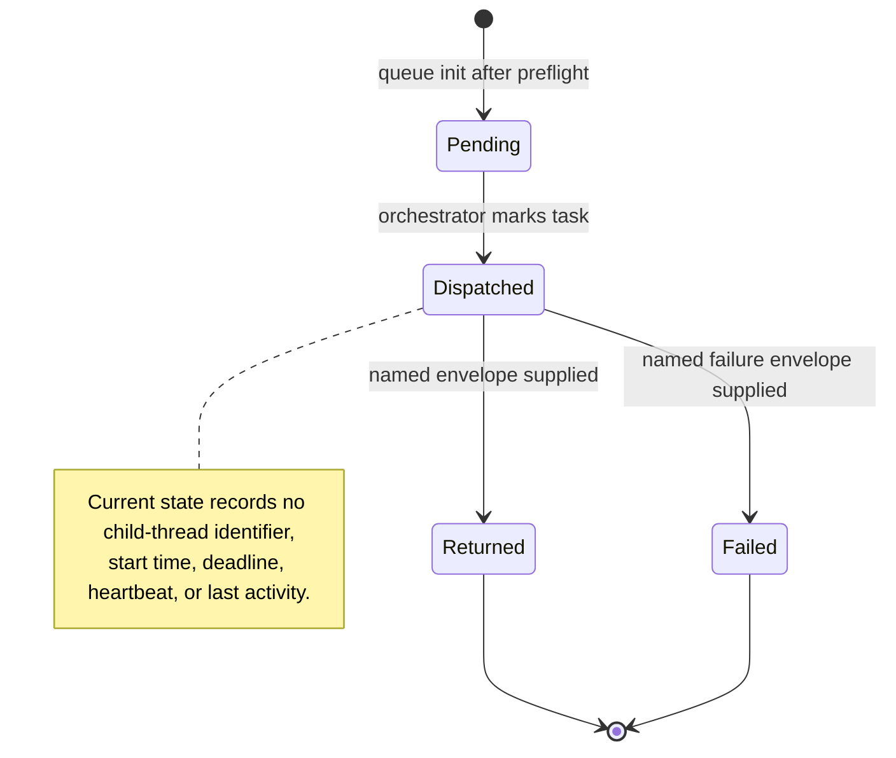
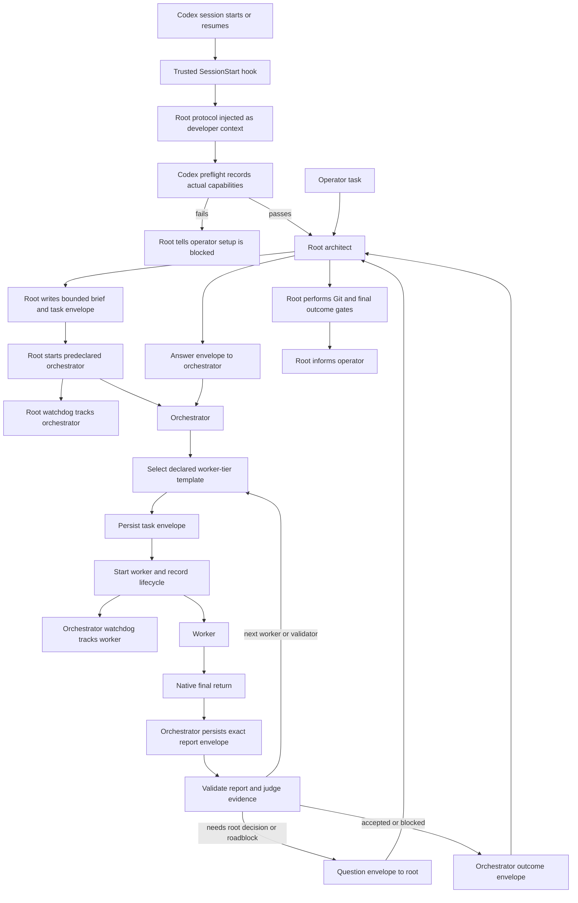
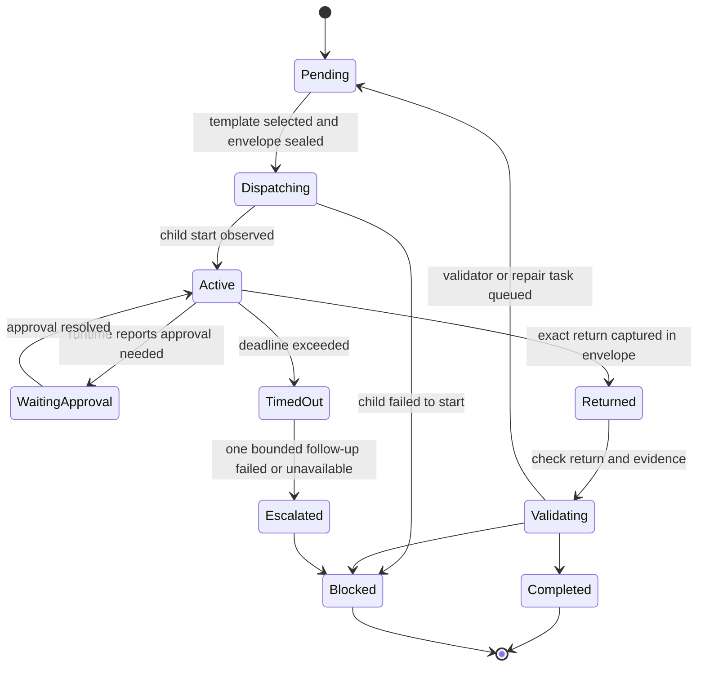

# Codex Adapter Runtime Audit

## What this report is

This report compares the required Root Architect Execution workflow with the
current Codex adapter. It is written for maintainers deciding what must change
before the adapter can be described as a working runtime rather than a set of
generated agent definitions.

The required workflow is:

1. A session-start mechanism loads the Root Architect protocol.
2. The main session operates as the root architect.
3. Root turns the operator request into a bounded brief and sends that brief to
   the orchestrator.
4. The orchestrator selects only predeclared worker templates, including a
   compatible model tier and reasoning strength, and allowed tools.
5. Workers return only to the orchestrator. Their raw returns are preserved as
   mailbox envelopes before the orchestrator judges them.
6. The orchestrator monitors workers and escalates an unresolved roadblock to
   root through an envelope.
7. Root monitors the orchestrator and is the only agent that informs the
   operator.

IMPORTANT:

1. The orchestrator sub-model template must include the Agent tool, so it can spawn sub-agents.
2. The workers template must NOT grant the Agent tool, and each template must be granted ONLY the tools it can use.

The current adapter is good at generating and installing templates. It is not
yet a proven implementation of this workflow.

## Scope and evidence

This is a read-only audit of the repository as it stood on 2026-09-19. It does
not change the adapter or claim a live Codex trial occurred.

The following static checks passed:

```text
python3 scripts/validate_roles.py --host codex
python3 scripts/render_agents.py --host codex --check
python3 scripts/validate_interfaces.py
python3 scripts/build_adapter.py --host codex --check
```

Those checks establish that role declarations, generated TOML files, interface
claims, and the committed bundle agree. They do not establish that Codex starts
the root protocol, allows the intended nested dispatch, carries an envelope,
or recovers a stalled agent. The adapter's own README makes the same distinction:
no Codex agent in this repository has yet dispatched another agent.

The broad Python test command is not currently a clean repository result. Its
Gemini bundle check fails because `dist/gemini` contains generated agent files
that the current Gemini layout no longer builds. That failure is outside the
Codex audit and must not be described as either a Codex pass or a Codex failure.

## Official OpenAI documentation used

The current official OpenAI documentation establishes these relevant facts:

- [Subagents](https://developers.openai.com/es-419/docs/agent-configuration/subagents):
  Codex supports custom agents in `.codex/agents`, nested agent workflows,
  model and reasoning configuration, and active-agent inspection. A custom
  agent file requires `name`, `description`, and `developer_instructions`.
  A `model` or `model_reasoning_effort` in that file overrides a value supplied
  when the agent is created.
- [Hooks](https://developers.openai.com/es-419/docs/hooks): Codex supports
  `SessionStart`, `SubagentStart`, `SubagentStop`, `PreToolUse`, and other
  lifecycle hooks. A `SessionStart` command may add developer context. Hook
  commands run with the session working directory.
- [Packaging a plugin](https://developers.openai.com/es-419/plugins/build/plugins):
  a plugin may provide `hooks/hooks.json`, and Codex discovers it when an
  explicit hook configuration is absent. Plugin hooks are untrusted until the
  user reviews and trusts them; installation alone does not activate them.

The adapter's host evidence instead points to older `/codex/subagents` and
`/codex/hooks` paths and a September 2026 command-line observation. That source
record must be refreshed before it is treated as current capability evidence.

## The current runtime, as implemented

The repository contains two incompatible stories.

The role definitions say that root dispatches the orchestrator, and that the
orchestrator dispatches workers. The root role explicitly names only
`orchestrator` as its child. The orchestrator role says it opens dispatches,
posts envelopes, and delegates workers.

The main skill and the runtime-workflow document still describe the earlier
shape: root sends work directly to the implementer, specification validator,
and quality validator. This is not a harmless documentation difference. Skills
and repository instructions are inputs to the model, so the old workflow can
cause a session to bypass the orchestrator layer that the newer role files
require.

The diagram below separates the actual files from behaviour that has merely
been described. Dashed arrows identify a manual or unproven step.

```mermaid
flowchart TD
    operator[Operator] --> main[Ordinary Codex main session]
    plugin[Plugin manifest: skill and default prompt] -. no SessionStart hook .-> main
    installer[Manual install.py] --> templates[.codex/agents TOML templates]
    templates -. makes templates available .-> main

    main -. model must choose protocol .-> root[Root protocol]
    root -. scope is instruction only .-> orch[Orchestrator template]
    orch -. native child return, not automatically enveloped .-> worker[Worker template]
    worker -. fenced JSON return .-> orch
    orch -. manual mailbox.py persistence required .-> mailbox[Filesystem mailbox]
    mailbox --> queue[Filesystem job queue]
    orch -. final JSON .-> root
    root --> operator
```

### What the job queue does now

`scripts/job_queue.py` is a durable state machine. It creates a queue only
after a passing preflight record exists. Each task moves forward only:
`pending` to `dispatched` to either `returned` or `failed`. It refuses a second
open task and requires an envelope name before recording a terminal state.



This is useful bookkeeping, but it is not monitoring. A task remains
`dispatched` until an agent chooses to mark it otherwise. The queue does not
know whether the worker exists, is waiting for approval, has exhausted its
budget, has become idle, or has returned output that was never persisted.

The current mailbox is also a strong file format, not a transport bridge. It
protects append-only envelopes and allows the orchestrator to seal a missing
worker result as a failure. However, a Codex worker returns its final message
to its parent agent. No adapter code captures that native return and posts its
literal bytes before the orchestrator evaluates it. `mailbox.py post` requires
a body file, while the orchestrator instructions permit only the queue and
mailbox scripts. The necessary conversion from native return to envelope is
therefore unspecified and untested.

## Findings

### Startup bootstrap is absent

The Codex manifest declares a skill and a default prompt but no hook
configuration. The Codex layout does not place a `hooks/` directory in the
bundle. The generated root template acknowledges that there is no automatic
startup prompt and relies on the model to run preflight first.

This fails the first required step. A session can begin as an ordinary Codex
session, receive an operator task, and never load the Root Architect protocol.
It also means a compacted or resumed session has no reliable mechanism to
restore the protocol.

Required change:

- Add a Codex `hooks/hooks.json` with a `SessionStart` handler matching
  `startup`, `resume`, and `compact`.
- Add a small hook program that emits the Root Architect protocol location,
  the installed plugin root, and an instruction to run the Codex preflight
  before work. The output must be developer context, not a user-visible hint.
- Ship the hook directory in `adapters/codex/layout.json` and the built bundle.
- Document the required user trust decision. If the hook is not trusted, the
  adapter must report that bootstrap is unavailable and fail closed rather than
  present a root-run claim.
- Test startup, resume, and compaction in an installed Codex session.

### Main-session root identity is not established

The project calls `root-architect.toml` a main-thread agent, but the adapter
only materializes it as a custom-agent template in `.codex/agents`. The
manifest does not select that template for the main session. A default prompt
is not an identity boundary.

The generated root template is honest that its ability to dispatch only the
orchestrator is not host-enforced. It also says that the host maps no delegation
tool in the adapter's capability matrix. The preflight script cannot repair
this by itself because it accepts a model-written observation.

Required change:

- Define the supported Codex launch contract explicitly: an ordinary main
  session receives the root protocol through `SessionStart`; it is not falsely
  described as an instance of the custom-agent template.
- Treat root-to-orchestrator-only dispatch as protocol policy until a live
  Codex capability proves it can be enforced. Do not call it isolated or
  hardware-enforced.
- Make the Codex preflight explicit: `root_preflight.py --host codex`.
  The current role prose omits `--host`, while the script defaults to
  `claude-code`. Following the prose exactly records and evaluates the wrong
  host contract.
- Record the actual root session identifier and the chosen orchestrator child
  identifier in durable run state, rather than relying only on a self-reported
  list of visible tools.

### Static worker models defeat task-based routing

The current worker templates hard-code their `model` and
`model_reasoning_effort`. The implementer is always the cheap/low template;
the validators are fixed as well. Official documentation says a value in a
custom-agent file overrides the values requested when creating that agent.
Consequently, an orchestrator cannot choose a stronger worker for a difficult
task merely by asking Codex to spawn one with a different model or effort.

The product requirement says to start with the cheapest plausible tier and
escalate only after recorded evidence. The current Codex templates make that
requirement impossible to apply accurately.

The selected remedy is **predeclared tier variants**. The orchestrator chooses
one named template; it never invents a new template and never relies on a
spawn-time model override.

| Worker family        | Template name              | Model tier | Reasoning | Use                                                           |
| -------------------- | -------------------------- | ---------- | --------- | ------------------------------------------------------------- |
| Implementation       | `impl-executor-cheap`      | cheap      | low       | Mechanical, tightly bounded edits.                            |
| Implementation       | `impl-executor-mid`        | mid        | medium    | Normal behaviour changes with tests.                          |
| Implementation       | `impl-executor-strong`     | strong     | high      | Coupled state, replay, authority, or a recorded escalation.   |
| Specification review | `spec-validator-mid`       | mid        | medium    | Ordinary plan-compliance review.                              |
| Specification review | `spec-validator-strong`    | strong     | high      | Ambiguous requirements or high-risk boundaries.               |
| Quality review       | `quality-validator-mid`    | mid        | medium    | Normal defect search and named command reruns.                |
| Quality review       | `quality-validator-strong` | strong     | high      | Security, concurrency, persistence, or a recorded escalation. |

The concrete model identifiers remain host-owned mappings. The current Codex
host mapping is cheap = `gpt-5.6-luna`, mid = `gpt-5.6-terra`, and strong =
`gpt-5.6-sol`. Each variant must be tested against the installed Codex version
because allowed reasoning strengths depend on the chosen model.

The role schema should gain `family`, `tier`, `model`, and `reasoning` fields.
The brief, queue record, envelope, and final outcome must record all four of:
the requested family, selected template name, resolved model, and resolved
reasoning strength. The capability gate must reject an undeclared template and
must verify that every declared variant renders into the installed agent
directory.

### Mailbox-only communication is not implemented

The desired boundary is worker → orchestrator → root. The worker must not
contact the operator or root directly, and the orchestrator must preserve the
worker's raw report before judging it.

Today the worker returns a fenced JSON block to its Codex parent. That is a
native parent-child result, not a mailbox envelope. The mailbox code correctly
forbids workers from writing envelopes, which is appropriate, but no Codex
adapter bridge makes the orchestrator persist the result it received.

Required change:

- Define a worker-return capture operation in the Codex adapter. It takes the
  exact native final message, writes an append-only `report` envelope with
  `persisted_by: orchestrator`, then returns the new envelope name.
- Run `check_return.py` against the envelope body, not an unrecorded text in
  the orchestrator's conversation.
- Require the queue transition to `returned` or `failed` immediately after
  envelope persistence. The queue must never reach a terminal state without a
  verified envelope hash.
- Use a separate `question` envelope for an escalation to root and an `answer`
  envelope for root's reply. Root does not send an informal follow-up directly
  to a worker.

### No worker or orchestrator monitoring exists

The job queue records logical state, not live state. There is no child-thread
identifier, progress timestamp, timeout, heartbeat, deadline, or recovery
action in the queue schema. The role prose says silence is not success, but it
only detects silence after someone runs a verification command and seals a
failure.

This misses both required monitoring loops:

- The orchestrator must notice that a worker is stuck and act before treating
  the task as complete.
- Root must notice that the orchestrator is idle or stuck and surface a
  roadblock to the operator rather than waiting forever.

Required change:

- Extend run state with `provider_thread_id`, `parent_thread_id`, `template`,
  `started_at`, `last_activity_at`, `deadline_at`, `status`, and
  `last_envelope`.
- Use `SubagentStart` and `SubagentStop` hooks to record lifecycle events.
  These hooks are useful for monitoring even though they do not currently
  provide the worker identity needed for write authorization.
- Define a watchdog interval and a deadline for each dispatched task. The
  watchdog must distinguish waiting-for-approval, active, completed, stopped,
  and unknown states.
- On a worker deadline, the orchestrator records a failure envelope, asks for
  status once if the Codex runtime supports a targeted follow-up, then marks
  the task blocked and sends root a question envelope. It must not silently
  retry or implement the task itself.
- On an orchestrator deadline, root records the missing progress, sends one
  bounded follow-up if supported, then tells the operator that work is blocked.
  The operator message must contain the reason, the last valid envelope, and
  the decision needed to continue.
- A real host trial must prove that the adapter can identify and follow up with
  the correct live child. If Codex exposes no stable child-control operation,
  automatic monitoring cannot be claimed; the design must state that limit.

### Root-versus-worker write isolation remains instructional

The adapter correctly documents that Codex `PreToolUse` does not give the
existing guard a reliable root-or-worker identity. A global write denial would
also deny the implementer. As a result, the root can still write product files
unless it follows its instructions, and an implementer can exceed its brief's
write paths unless it follows its instructions.

This is a material limitation, not a wording problem. The product must not
claim host-enforced write isolation on Codex until a documented and live-tested
identity correlation exists, or until a different enforcement mechanism is
implemented. One possible mechanism already named in the adapter documentation
is an approved patch digest: root approves an exact path/before/after digest
and a hook admits only that patch. That mechanism is not built today.

### Documentation and provenance are inconsistent

The following documents must be brought into agreement before implementation:

- `SKILL.md` still diagrams direct root-to-worker dispatch.
- `docs/02-design/workflows.md` still diagrams direct root-to-worker dispatch.
- `references/agents/root-architect.md` omits `--host codex` from preflight.
- `docs/04-operations/deployment.md` documents only manual template
  materialization for Codex. It does not document a trusted startup hook,
  startup/restart behaviour, or the failure mode when hook trust is absent.
- `hosts/codex.json` and `adapters/codex/agent-interface.json` carry dated
  evidence and old documentation URLs. They need current official references
  and a fresh installed-host observation.
- `docs/01-architecture/architecture.md` describes guards generically. It
  should explicitly say that Codex write isolation is not currently enforced.

## The required runtime

The following is the target flow. It preserves root ownership of operator
communication, plan, Git, and final acceptance while moving all product work
and worker decisions below the orchestrator.



### Required queue and monitoring model

The queue should remain the durable source of order, but gain lifecycle data.
The agent runtime remains the source of live child status. Neither substitutes
for the other.



The following rules make the diagram operational:

1. Only root may create an orchestrator run record and communicate with the
   operator.
2. Only the orchestrator may select a worker variant, open a worker task, and
   capture a worker return.
3. A worker cannot create another worker, contact root, or mark a queue state.
4. Every terminal queue state names a verified envelope.
5. A timeout is an explicit state and envelope, never an absence of output.
6. A model tier change is a new selected template with a recorded reason; it
   cannot occur invisibly through inherited configuration.
7. An untrusted hook, a missing lifecycle event, or an unknown child status is
   a blocked condition, not evidence that the run is healthy.

## Delivery plan

1. Correct the documentation and host evidence first. Remove the direct
   root-to-worker diagrams and refresh the official Codex references.
2. Add Codex startup and lifecycle hooks, package them, document trust, and
   make the root bootstrap fail closed when the hook is unavailable.
3. Correct preflight host selection and add a Codex-specific preflight fixture.
4. Add the named tier variants, model them as families and variants in the
   schemas, and update renderer, installer, capability checks, and tests.
5. Add native-return capture into the append-only mailbox and make queue
   transitions depend on that capture.
6. Extend queue state with lifecycle and timeout fields, then implement
   orchestrator and root watchdog behaviour.
7. Run an installed Codex acceptance trial covering normal completion, a worker
   blocked on missing information, a worker that goes idle, an orchestrator
   that goes idle, a rejected malformed report, and a model-tier escalation.

## Completion criteria

The Codex adapter is ready to claim the required workflow only when an
installed-host trial demonstrates all of the following:

- A trusted session-start hook injects root protocol on startup, resume, and
  compaction.
- Root starts only the predeclared orchestrator in the documented protocol.
- The orchestrator selects only named, installed worker-tier variants.
- Each selected worker's template name, model, and reasoning strength are
  present in the brief, queue, envelope, and outcome record.
- Worker returns are persisted verbatim before validation and are visible to
  root only through envelopes and the orchestrator outcome.
- The orchestrator detects and escalates a stalled worker.
- Root detects and reports a stalled orchestrator.
- No path claims that Codex host-enforces root-versus-worker write separation
  unless a new identity or patch-admission mechanism has been proven.

Until then, the accurate status is: **Codex template generation and installation
are validated; the required autonomous orchestration runtime is not.**

## Repository references

- `roles/root-architect.json`
- `roles/orchestrator.json`
- `hosts/codex.json`
- `adapters/codex/manifest.template.json`
- `adapters/codex/layout.json`
- `adapters/codex/agent-interface.json`
- `adapters/codex/agents/root-architect.toml`
- `adapters/codex/agents/orchestrator.toml`
- `adapters/codex/agents/impl-executor.toml`
- `scripts/root_preflight.py`
- `scripts/job_queue.py`
- `scripts/mailbox.py`
- `SKILL.md`
- `docs/02-design/workflows.md`
